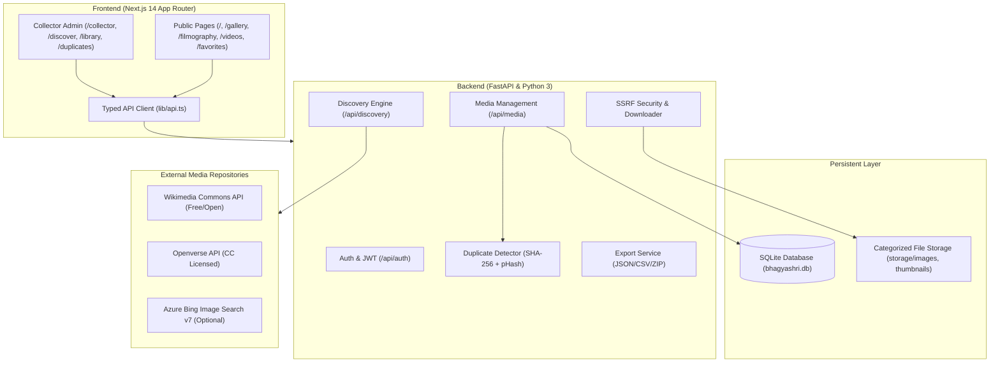

# Architecture & System Design: A World of Bhagyashri

## 1. System Overview

"A World of Bhagyashri" is a unified full-stack application designed with two distinct tiers:
1. **Public Fan Experience**: An editorial tribute website celebrating Indian actress Bhagyashri Borse.
2. **Private Media Collector**: An integrated media discovery, duplicate detection, and library management engine.



## 2. Media Lifecycle & Security Architecture

The system enforces a strict 4-stage media lifecycle:

```
[EXTERNAL SEARCH] ──> [DISCOVERED CANDIDATES] ──> [HUMAN CURATOR REVIEW] ──> [APPROVED & PUBLISHED]
                             │                                 │
                             └──> [EXCLUDED / DUPLICATE] <─────┘
```

### Security Defenses:
- **SSRF Prevention**: Before any remote media URL is fetched, the hostname is resolved via DNS and checked against private/internal IPv4/IPv6 ranges (e.g. `127.0.0.0/8`, `10.0.0.0/8`, `192.168.0.0/16`, link-local `169.254.169.254`). Redirects are re-validated on every hop.
- **Payload Verification**: Downloaded bytes are limited to 15MB max and verified via Pillow's byte-level image header verification.
- **Gallery Protection**: Public unauthenticated API endpoints filter exclusively for `review_status == 'approved'`. Unapproved and pending media cannot be queried without valid JWT tokens.
